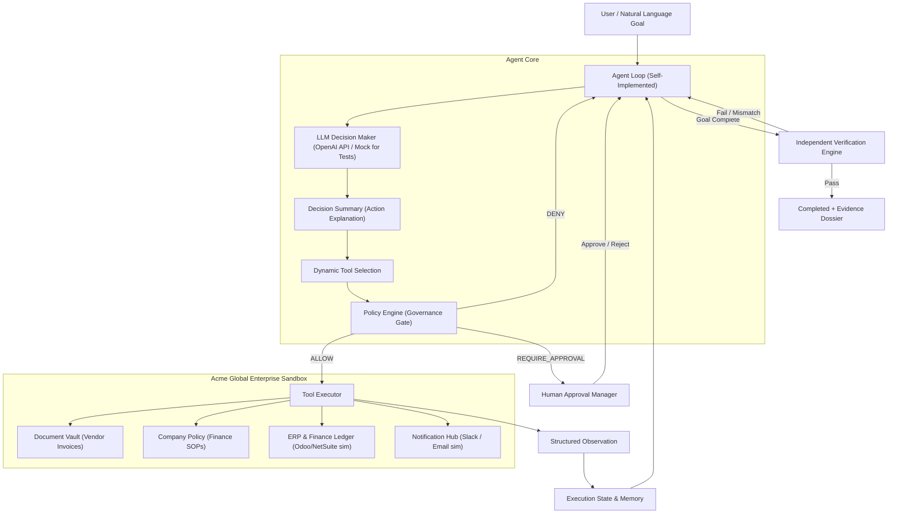
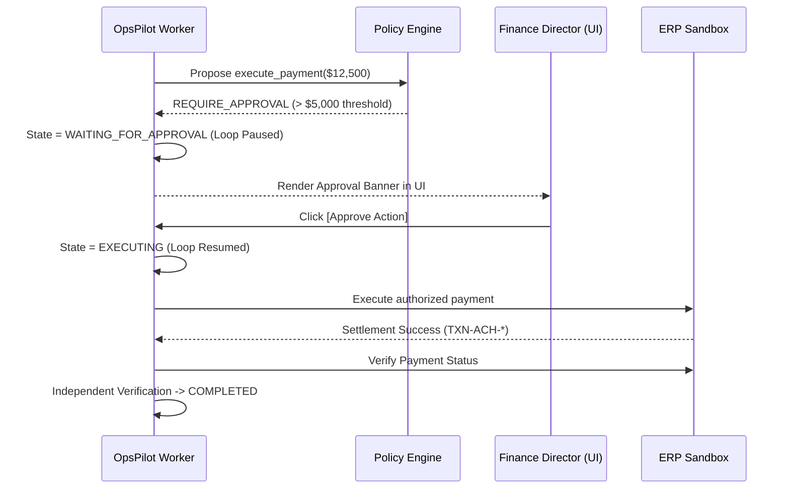

# OpsPilot — Autonomous Enterprise Operations Worker

> Built for the **CentrAlign AI** Engineering Hiring Evaluation.
> An autonomous AI worker that processes enterprise workflows across document repositories, ERP ledgers, and communications channels, dynamically selects tools, consults internal operating procedures, adapts after failures, enforces human-in-the-loop policy governance, and independently verifies the final business outcome.

---

## 1. Problem

Enterprise knowledge workers spend thousands of hours manually executing repetitive operational workflows across fragmented business software: downloading vendor invoices from email/portals, cross-referencing accounts payable ledgers in ERP systems (like NetSuite or Odoo), consulting company spending policies, scheduling bank settlements, notifying stakeholders, and auditing discrepancies.

Traditional robotic process automation (RPA) and hard-coded scripts break fragilely whenever unexpected events occur:
- A bank gateway encounters a transient timeout.
- A vendor submits a duplicate invoice that was already paid.
- An invoice exceeds spending thresholds requiring manager authorization.
- An API returns a `200 OK` but leaves the database records inconsistent.

CentrAlign AI is building **AI Employees** that map how an enterprise operates into an **Organization Graph**, connecting tools, knowledge, and policies to turn recurring business work into autonomous, self-healing workers.

---

## 2. Solution

**OpsPilot** is a production-grade working prototype of an autonomous enterprise worker. Given a natural-language goal such as:

> *"Process the latest unpaid vendor invoice. Verify that it isn't already recorded, follow company payment policy, and complete payment if authorized."*

OpsPilot does **not** follow a hardcoded procedural script (`step1 -> step2 -> step3`). Instead, it executes an autonomous evaluation loop:

$$\text{Goal} \longrightarrow \text{Understand} \longrightarrow \text{Plan} \longrightarrow \text{Execute} \longrightarrow \text{Observe} \longrightarrow \text{Adapt} \longrightarrow \text{Verify} \longrightarrow \text{Complete}$$

- **Dynamic Tool Selection**: The LLM evaluates observations from previous steps and selects the appropriate tool dynamically.
- **Dynamic Policy Retrieval**: The worker independently searches and reads company operating procedures (`company_policy.md`) to discover authorization thresholds ($5,000 autonomous limit) and compliance rules.
- **Policy Engine Governance**: An explicit governance layer outside the LLM intercepts all proposed actions, evaluating them against `ALLOW`, `REQUIRE_APPROVAL`, or `DENY`.
- **Failure Adaptation**: When an action fails (e.g. 503 bank gateway timeout), the worker observes the error, assesses idempotency, and autonomously recovers.
- **Human Approval**: High-value settlements ($\ge \$5,000$) pause the agent loop, waiting for human manager authorization before resuming execution seamlessly.
- **Independent Verification**: Tool return codes are never trusted as proof of completion. An independent verification engine evaluates real ground truth in the sandbox before producing an Evidence Dossier.

---

## 3. Architecture



---

## 4. The Agent Loop

OpsPilot implements its central loop directly in TypeScript (`backend/src/agent/agentLoop.ts`) rather than hiding behavior inside opaque frameworks like LangChain, CrewAI, or AutoGen:

1. **Understand Goal & Context**: The loop gathers current execution state, step history, and environment feedback.
2. **LLM Decision Step**: Sends conversation history and JSON tool schemas to the model (`gpt-4o-mini`). The model produces a concise **Decision Summary** and proposes a tool call or declares completion.
3. **Policy Authorization Gate**: The proposed tool call is evaluated by the external **Policy Engine**:
   - `ALLOW`: Proceed to execution.
   - `REQUIRE_APPROVAL`: Pause execution, transition state to `WAITING_FOR_APPROVAL`, and notify human manager via UI/API.
   - `DENY`: Inject policy violation observation to model, allowing it to adapt.
4. **Tool Execution in Sandbox**: Tool executes against the mutable state of **Acme Global Enterprise**.
5. **Observation Capture**: Structured JSON output (e.g. error codes, status flags, record IDs) is fed back to the model context.
6. **Adaptation / Recovery**: If an error is returned (e.g. `GATEWAY_TIMEOUT`), the model observes `retryable: true`, checks state, and retries.
7. **Independent Verification**: When the model declares completion, the **Independent Verifier** inspects ground truth in the ERP ledger, checks settlement transaction hashes, amounts, and audit notifications.
8. **Evidence Dossier**: If verified, status becomes `COMPLETED` and an auditable dossier is produced.

---

## 5. Autonomous Components

| Component | Nature | Description |
| :--- | :--- | :--- |
| **Tool Choice** | **Genuinely Autonomous** | The LLM dynamically chooses which tool to invoke next based on prior observations. No fixed script or hardcoded state machine exists. |
| **Document Discovery** | **Genuinely Autonomous** | The model searches the invoice vault, inspects dates, and selects the target invoice document dynamically. |
| **Policy Retrieval** | **Genuinely Autonomous** | The agent searches and reads internal company SOPs to discover spending limits and approval requirements rather than relying on prompt hardcoding. |
| **Failure Recovery** | **Genuinely Autonomous** | When a tool fails (e.g. 503 Gateway Timeout), the agent reads the error observation, decides whether to retry or escalate, and adapts. |
| **Human Escalation** | **Genuinely Autonomous** | When policy limits or discrepancies are detected, the agent requests human authorization and cleanly resumes execution upon approval. |
| **Independent Verification** | **Deterministic & Guarded** | Code-level verification engine that independently validates ground truth in the database before signing off on task completion. |

---

## 6. Tools

OpsPilot exposes 10 strongly-typed tools validated with Zod schemas:

1. `search_documents(query?, status?)`: Searches the document vault by vendor, keyword, or status (`UNPAID`, `PAID`).
2. `read_document(documentId)`: Reads complete line items, amounts, bank accounts, and payment terms of an invoice.
3. `search_company_policy(query?)`: Searches company operating procedures, spending limits, and compliance SOPs.
4. `read_company_policy(sectionName?)`: Retrieves specific clauses from `company_policy.md`.
5. `query_finance_records(invoiceNumber?, vendor?, status?)`: Queries the ERP ledger for existing invoices and status.
6. `record_invoice(invoiceNumber)`: Registers an incoming verified invoice into the ERP ledger with status `RECORDED`.
7. `execute_payment(invoiceNumber, amount)`: Dispatches ACH/Wire payment settlement via the bank gateway.
8. `verify_payment_status(invoiceNumber)`: Probes the ERP ledger to verify settlement status and transaction reference.
9. `send_notification(channel, message)`: Dispatches audit alerts to Slack channels (e.g. `#finance-approvals`).
10. `request_human_approval(action, reason, amount?)`: Explicitly requests authorization from the Finance Director.

---

## 7. Policy System (ALLOW / REQUIRE_APPROVAL / DENY)

The Policy Engine (`backend/src/policy/policyEngine.ts`) enforces corporate financial governance independently from the LLM:

- **`ALLOW`**: Low-risk inspection tools (`search_documents`, `read_document`, `read_company_policy`, `query_finance_records`), ERP invoice recording, audit notifications, and payments **below $5,000.00**.
- **`REQUIRE_APPROVAL`**: Payments **equal to or exceeding $5,000.00** (e.g. Snowflake Enterprise License for $12,500.00). The agent loop pauses, task enters `WAITING_FOR_APPROVAL`, and the UI renders an Approval Modal. Human manager approval immediately resumes the same task.
- **`DENY`**: Unauthorized actions, shell execution, or attempts to pay duplicate invoices already marked `PAID` in the ERP.

---

## 8. Failure Recovery Demo

The sandbox includes a developer control: **"Failure Mode (503 Injected)"**.

When enabled:
1. The first `execute_payment` call fails with a simulated bank gateway partition:
   ```json
   {
     "success": false,
     "error": "GATEWAY_TIMEOUT",
     "message": "Bank settlement gateway timed out during transaction settlement. No funds debited. Transient network partition detected.",
     "retryable": true
   }
   ```
2. The agent loop receives this observation.
3. The LLM evaluates the error, recognizes that `retryable: true` and no funds were settled, and issues an action decision:
   *"Payment settlement encountered transient error (GATEWAY_TIMEOUT). Adapting by executing immediate retry."*
4. The second attempt succeeds (`TXN-ACH-...` generated).
5. The agent independently verifies the outcome and completes the task.

---

## 9. Verification (Why Tool Success $\neq$ Task Success)

CentrAlign explicitly evaluates whether an AI worker can prove its outcome. Treating `execute_payment() -> 200 OK` as task success is dangerous: the transaction might have dropped, the ledger might be unupdated, or the amount might differ from the invoice.

The **Independent Verification Engine** checks 5 ground-truth criteria before marking the task `COMPLETED`:
1. **ERP Ledger Existence**: Invoice is registered in the ERP database.
2. **Settlement Status Verification**: Record status is strictly `PAID`.
3. **Bank Settlement Reference**: A valid, unique settlement transaction ID (`TXN-ACH-...`) is committed.
4. **Amount Integrity & Reconciliation**: The settled ledger amount precisely matches the original invoice document amount.
5. **Stakeholder Notification Audit**: A confirmation alert was dispatched to `#finance-approvals`.

---

## 10. Human-in-the-Loop Approval Flow



---

## 11. Setup & Installation

### Prerequisites
- Node.js $\ge 18.20.0$
- npm $\ge 10.0.0$

### 1. Clone Repository & Install All Dependencies
```bash
git clone https://github.com/syamtammireddy/ops-pilot.git
cd ops-pilot

# Install root, backend, and frontend dependencies in one command
npm run install:all
```

### 2. Environment Variables
Copy `.env.example` to `.env`:
```bash
cp .env.example .env
```

Edit `.env` if you wish to use live OpenAI models:
```env
# Optional: Set your OpenAI API key for live LLM reasoning
OPENAI_API_KEY=your_openai_api_key_here
OPENAI_MODEL=gpt-4o-mini

# Server & Client Ports
PORT=4000
VITE_API_URL=http://localhost:4000
```
> **Note on Offline / Mock Mode**: If `OPENAI_API_KEY` is omitted or set to `mock`, OpsPilot automatically runs in deterministic mock mode. Every tool, sandbox state transition, failure recovery, approval gate, and verification check functions identically offline without external network dependencies.

---

## 12. Running the Application

### Option A: 1-Command Monorepo Dev (Recommended)
From the root directory:
```bash
npm run dev
```
- Backend starts at: `http://localhost:4000`
- Frontend UI opens at: `http://localhost:5173`

### Option B: Separate Terminals
```bash
# Terminal 1: Backend
npm run dev:backend

# Terminal 2: Frontend
npm run dev:frontend
```

### Option C: Docker Compose
```bash
docker-compose up --build
```

---

## 13. Running Automated Tests

OpsPilot includes a comprehensive test suite with unit tests and end-to-end integration tests:

```bash
# Run all unit and integration tests
npm test
```

Test coverage includes:
- `policy.test.ts`: Policy authorization rules, payment thresholds, duplicate detection, and denial of arbitrary actions.
- `tools.test.ts`: Zod schema validation, parameter checking, and error handling.
- `verifier.test.ts`: Ground-truth verification logic (partial vs settled states).
- `autonomousFlow.test.ts`: Full autonomous invoice discovery, policy lookup, ERP recording, payment, verification, and evidence dossier generation.
- `failureRecovery.test.ts`: Failure injection mode with 503 gateway timeout, error observation, and autonomous retry recovery.
- `approvalGate.test.ts`: High-value invoice ($12,500), policy interception, pause at `WAITING_FOR_APPROVAL`, human approval, and resumed completion.

---

## 14. Demo Walkthrough Script (2–3 Minutes)

1. Open the UI at `http://localhost:5173`.
2. **Scenario 1 — Primary Autonomous Flow**:
   - Click the preset button: **"1. Standard Autonomous Invoice"**.
   - Click **"Run Autonomous Worker"**.
   - Watch the live execution trace stream in real-time via Server-Sent Events.
   - Observe the agent discover `INV-2024-001`, inspect details ($4,200), query ERP, read company policy, record invoice, execute payment, verify in ERP, and alert `#finance-approvals`.
   - Point out the **Independent Verification Dossier** with 5/5 passed checks.
3. **Scenario 2 — Failure Recovery**:
   - Click **"2. Failure Injection & Recovery"** (automatically turns Failure Mode ON).
   - Click **"Run Autonomous Worker"**.
   - Step 6 fails with a red badge: `GATEWAY_TIMEOUT (503)`.
   - Observe Step 7: The agent reads `retryable: true`, adapts, and retries payment immediately.
   - Step 8 verifies successful settlement in ERP.
4. **Scenario 3 — Human Approval Gate**:
   - Click **"3. High-Value Approval Gate"** (Snowflake $12,500 invoice).
   - Click **"Run Autonomous Worker"**.
   - Worker pauses with amber badge: `WAITING_FOR_APPROVAL`.
   - The red **Approval Banner** pops up citing the policy violation ($12,500 $\ge$ $5,000 limit).
   - Click **"Approve & Authorize Settlement"**.
   - The worker seamlessly resumes, completes payment, verifies ERP, and produces the evidence dossier.

---

## 15. Known Limitations

- **Simulated External Connectors**: The sandbox simulates Odoo/NetSuite and bank ACH gateways via an in-memory stateful store rather than live third-party cloud SaaS environments.
- **Single Active Human Session**: Human approvals are handled synchronously via REST/SSE rather than multi-channel Slack interactive buttons.
- **Synchronous Webhook Delivery**: Internal notifications are pushed to an in-memory channel rather than an external Slack/Discord webhook.

---

## 16. What I Would Build With 2 More Weeks

1. **Organization Graph Integration**: Build an interactive graph mapping company entities (departments, vendor agreements, approval matrices, and database tables) inspired directly by CentrAlign's Centra engine.
2. **Real Enterprise Connectors**: Add live OAuth2 connectors for NetSuite SuiteTalk REST API, Odoo XML-RPC, and Stripe Treasury.
3. **Interactive Slack Bot**: Deliver human approval requests directly to Slack with interactive `[Approve]` and `[Reject]` buttons using Slack Block Kit.
4. **Persistent Vector Knowledge Vault**: Replace the flat policy document with an embedding-backed policy retrieval index over thousands of corporate SOPs.
5. **Computer Use & Browser Automation**: Connect an automated browser worker (Playwright / Chrome DevTools) to log into legacy vendor portals and download invoices that lack API access.
6. **Distributed Queue & Worker Scaling**: Back task execution with BullMQ / Redis to support thousands of parallel background AI workers across multiple tenant enterprises.

---

## 17. Disclosures

- **AI Coding Tools**: AI coding assistants (Gemini / Antigravity) were used for ideation, scaffolding, and pair programming during development.
- **External Libraries**: Standard open-source libraries used: `express`, `cors`, `zod`, `openai`, `react`, `vite`, `lucide-react`, `jest`, `ts-jest`. No external agent framework (LangChain, CrewAI, AutoGen) was used; the core agent loop was engineered from scratch.
